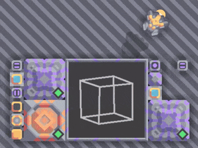
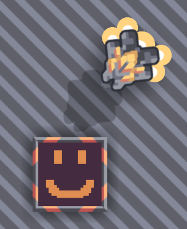

<!-- ::what-is-mindustry -->

## Le projet

Mindustry propose des blocs qui permettent aux joueurs de dessiner des images. On peut faire des choses assez sympa avec.

<!-- ::start:gallery -->

<!-- ::end:gallery -->

Certains joueurs s'en servent pour afficher des images pornographiques sur les serveurs publics. Les autres joueurs, y compris les enfants, peuvent les voir avant qu'un modérateur intervienne.

NoHorny repère ces blocs, en extrait les images et les envoie à un serveur de classification. Si une image est jugée inappropriée, il supprime les blocs et bannit le joueur responsable.

## Le défi

NoHorny doit traiter les blocs en ralentissant le moins possible la boucle principale du jeu.

Pour ça, je regroupe les blocs voisins sur plusieurs ticks de jeu, puis je génère l'image complète et l'envoie à la classification dans des threads en arrière-plan.

Côté serveur de classification, je voulais limiter les coûts. J'utilise donc d'abord un [modèle de classification local](https://huggingface.co/Falconsai/nsfw_image_detection_26?not-for-all-audiences=true). Il est assez précis et l'analyse prend environ 150 ms. Mais une image très grande ou inhabituelle peut être signalée à tort.

Pour corriger ça, je le combine avec [Sightengine](https://sightengine.com/), un service de modération de contenu. Le modèle local écarte les images clairement acceptables et Sightengine vérifie le reste.

Ça me permet de proposer un service de classification public et gratuit aux autres propriétaires de serveurs.

## En pratique

Plusieurs réseaux de serveurs Mindustry utilisent maintenant NoHorny. Je continue de travailler avec eux pour faciliter son installation et l'adapter à leurs besoins.

Par exemple, NoHorny peut envoyer des alertes via les webhooks Discord, mais certains serveurs sont hébergés dans des pays où Discord est bloqué. J'ai donc ajouté un outil qui récupère des proxys gratuits et fait passer les requêtes des webhooks par ceux-ci.
